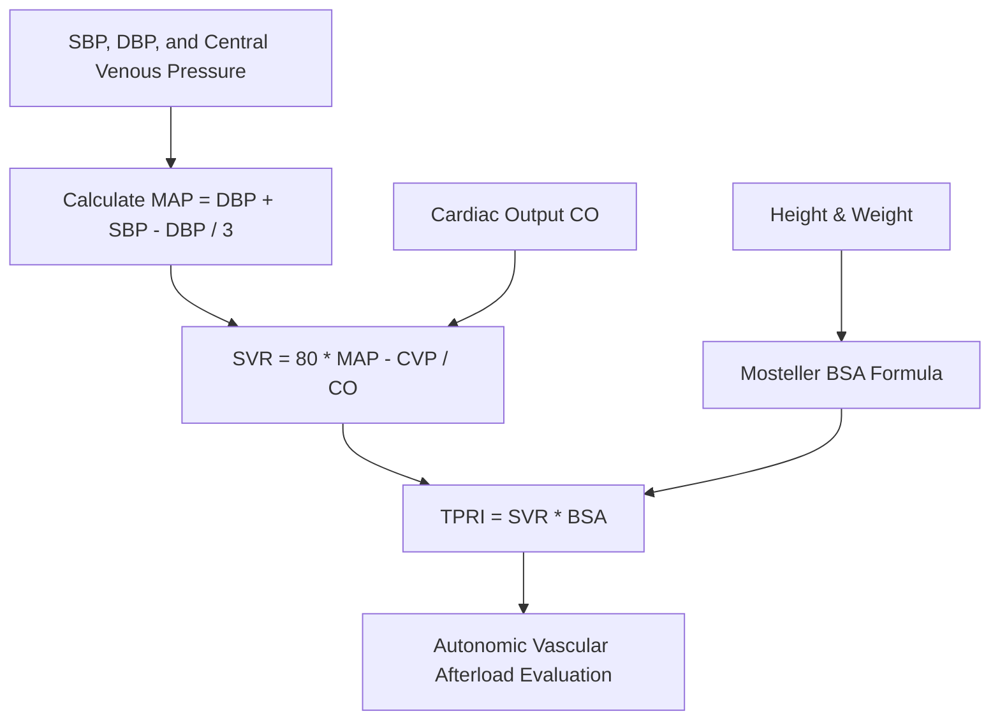

# Cardiac Total Peripheral Resistance Index (TPRI) Skill

[](LICENSE)
[](https://www.python.org/)
[](https://openclaw.org/)
[](https://alphapark.ai/)
[](https://modelcontextprotocol.io/)

Systemic Vascular Resistance (SVR) and Total Peripheral Resistance Index (TPRI) Quantitative Analyzer. Evaluates left-ventricular afterload and peripheral vascular compliance.



## Features
- **Zero PIP Dependencies**: Implemented strictly with Python Standard Library (`math`, `json`, `sys`, `typing`).
- **Standard Cardiovascular Hemodynamics**: Evaluates SVR in dyn*s/cm^5 and indexed TPRI in dyn*s*cm^-5*m^2.
- **Precision Anthropometry**: Incorporates Mosteller body surface area adjustment.
- **Dual Architecture**: Native Python import and Model Context Protocol (MCP) JSON-RPC 2.0 stdio server.

## Quickstart
```bash
python example_usage.py
```

## License
Apache-2.0
